  

# ⚡ Awesome Autonomous Actuarial & Risk Advisory Systems 🌐

### *Curated Directory of Enterprise SaaS & Open-Source Actuarial Software, Pricing Engines, Reserving Platforms & Quantitative Risk Systems*

---

## 📖 Overview & SEO Summary 🚀

Welcome to the definitive, search-optimized index of **Autonomous Actuarial & Risk Advisory Systems**, **InsurTech analytics engines**, and **quantitative risk modeling frameworks**. 

Modern insurers, reinsurers, brokers, and enterprise risk management (ERM) teams are shifting from legacy batch spreadsheets to automated, machine learning-driven actuarial systems. This ecosystem tracker catalogs both tier-1 **commercial SaaS platforms** and transparent **open-source GitHub repositories** powering:
- 📊 **P&C Loss Reserving**: Automated chain-ladder algorithms, stochastic reserving, triangle manipulation, and IBNR predictions.
- ⚡ **Dynamic Pricing & Rating**: Automated Generalized Linear Models (GLMs), machine learning rate elasticity engines, and real-time underwriting APIs.
- 🌪️ **Catastrophe (Cat) Modeling**: Physical and liability catastrophe simulation, open loss modeling frameworks, and hazard exposure analytics.
- 🛡️ **Cyber Risk Quantification (CRQ)**: Bayesian and FAIR-compliant cyber event simulation, loss exceedance distributions, and security control ROI calibration.
- 📈 **Life & Health Modeling**: Cash flow projections, life contingencies, asset-liability management (ALM), and demography analysis.

---

## 📑 Table of Contents 📌

- [Sector Overview & Market Dynamics](#-sector-overview--market-dynamics)
- [Enterprise SaaS & Commercial Platforms](#-enterprise-saas--commercial-platforms)
- [Open-Source GitHub Projects](#-open-source-github-projects)
- [How to Contribute](#-how-to-contribute)
- [Star History](#-star-history)
- [Support](#-support)
- [Disclaimer](#-disclaimer)

---

## 🌐 Sector Overview & Market Dynamics

The global **Actuarial Modeling Software market** is valued at approximately **$1.8B – $2.4B** (scaling toward $4B+ by 2032 at ~12% CAGR), while the broader **Risk Analytics market** exceeds **$45B – $50B** (projected past $100B at ~11% CAGR).

The sector exhibits dual competitive dynamics:
1. **Core Actuarial Modeling is Highly Concentrated (Oligopolistic):** Dominated by legacy incumbents (Moody's, WTW, Milliman, FIS) with extreme barrier-to-entry dynamics driven by mission-critical regulatory compliance (IFRS 17, Solvency II, LDTI) and high carrier switching costs.
2. **Pricing Optimization & Cyber/Specialty Risk are Moderately Fragmented:** Modern cloud-native innovators (Akur8, Hyperexponential, Earnix, CyberCube, Kovrr) are rapidly capturing market share through automated AI rate-making, algorithmic underwriting APIs, and advanced cyber risk quantification.

---

## 🏢 Enterprise SaaS & Commercial Platforms

The following table provides verified commercial data for enterprise actuarial, pricing, and risk management SaaS systems. 

*Table sorted by **Company Size (Revenue / Market Cap / Valuation)** in descending order.*

| Platform | Domain & Description | Company Size (Revenue / Valuation) | Pricing (Starting Tier) | Free Tier / Trial Limits |
| :--- | :--- | :--- | :--- | :--- |
| **[Moody's Analytics](https://www.moodysanalytics.com/)** | Catastrophe modeling (RMS), IFRS 17 actuarial cash flow projections, and regulatory risk modeling. | **$6.5B+ Annual Revenue** ($80B+ Public Market Cap) | Starting from ~$50,000/year base platform subscription per risk domain | No permanent free tier; guided sandbox demo with structured sample data upon credentialed enterprise vetting |
| **[Willis Towers Watson ResQ](https://www.wtwco.com/en-us/solutions/products/resq)** | Enterprise P&C loss reserving, stochastic IBNR estimation, and financial reporting engine. | **$9.5B+ Annual Revenue** ($30B+ Public Market Cap) | Starting from ~$40,000/year per reserving business unit deployment | No permanent free tier; time-limited 30-day proof-of-concept (PoC) evaluation for qualified insurance carriers |
| **[Guidewire Analytics](https://www.guidewire.com/)** | Cloud-native predictive underwriting, risk scoring, and claims portfolio loss analytics (InsuranceSuite). | **$980M+ Annual Revenue** ($16B+ Public Market Cap) | Starting from ~$35,000/year integrated add-on tier to core Guidewire Cloud platform | No permanent free tier; 30-day enterprise sandbox pilot restricted to current Guidewire ecosystem customers |
| **[Earnix](https://earnix.com/)** | Real-time pricing optimization, price elasticity modeling, and rate deployment for insurance & banking. | **~$1.0B Valuation** (~$65M ARR) | Starting from ~$5,000/month (~$60,000/year) baseline deployment package | No permanent free tier; interactive guided proof-of-concept simulation environment for verified carriers |
| **[Akur8](https://www.akur8.com/)** | AI-driven transparent P&C insurance pricing, rate-making automation, and regulatory filing generation. | **~$430M Valuation** (~$25M+ ARR, $180M raised) | Starting from ~$3,000/month (~$36,000/year) entry tier for single-line regional carriers | No permanent free tier; structured 14-day assisted pilot using carrier historical claim loss datasets |
| **[CyberCube](https://www.cybercube.com/)** | Cyber risk accumulation modeling, underwriting single-risk scoring, and catastrophic cyber scenarios. | **~$400M Valuation** (~$35M ARR, $285M raised) | Starting from ~$2,500/month (~$30,000/year) baseline Broking Manager tier | No permanent free tier; tailored 14-day interactive trial on sample broker portfolios |
| **[Hyperexponential](https://www.hyperexponential.com/)** | Modern pricing decision intelligence platform (hx Renew) purpose-built for commercial & specialty P&C lines. | **~$350M Valuation** (~$25M–$35M ARR, $91M raised) | Starting from ~$2,500/month (~$30,000/year) base license for boutique MGAs | No permanent free tier; bespoke 30-day guided pilot testing live actuarial rate models |
| **[Milliman Arius](https://www.milliman.com/en/products/arius)** | Specialized P&C loss reserving system featuring deterministic, stochastic Mack, and Bornhuetter-Ferguson methods. | **Part of Milliman Consulting** (~$1.4B Firm Revenue) | Starting from ~$1,500/month (~$18,000/year) single-seat analyst license | No permanent free tier; 30-day full-feature desktop evaluation license upon actuarial qualification |
| **[Praedicat](https://www.praedicat.com/)** | Liability catastrophe modeling and latent mass-tort exposure quantification (acquired by Moody's). | **Acquired by Moody's** (~$5M historical ARR) | Starting from ~$20,000/year data intelligence and liability analytics subscription | No permanent free tier; custom demonstration risk analysis report on sample exposure lines |
| **[Kovrr](https://kovrr.com/)** | Cyber Risk Quantification (CRQ), portfolio aggregation modeling, and financial loss distribution simulation. | **~$25M Valuation** (~$4M–$5M ARR) | Starting from ~$1,250/month (~$15,000/year) base cyber exposure tier | Free online self-service NIST/ISO cyber risk score assessment; 14-day platform trial on request |

---

## 💻 Open-Source GitHub Projects

Community-driven, transparent, and auditable open-source libraries for actuarial science, loss reserving, catastrophe modeling, and cyber risk quantification.

*Sorted by **GitHub Star Count** in descending order.*

### 1. [OpenQuake Engine](https://github.com/gem/oq-engine) 
- **Primary Domain**: 🌪️ Catastrophe Modeling & Seismic Hazard Analysis
- **Tech Stack**: Python (AGPL-3.0)
- **Description**: The Global Earthquake Model (GEM) foundation's flagship open-source catastrophe modeling engine. Calculates seismic hazard and physical risk loss exceedance curves for commercial insurance and disaster resilience worldwide.

### 2. [chainladder-python](https://github.com/casact/chainladder-python) 
- **Primary Domain**: 📊 P&C Loss Reserving & Triangles
- **Tech Stack**: Python (MPL-2.0)
- **Description**: Casualty Actuarial Society (CAS) endorsed package for Property & Casualty loss reserving. Provides Pandas-like manipulation of triangular development data, Bornhuetter-Ferguson, Mack, bootstrap reserving models, and regulatory IBNR estimations.

### 3. [lifelib](https://github.com/lifelib-dev/lifelib) 
- **Primary Domain**: 📈 Life Insurance Actuarial Projections
- **Tech Stack**: Python (MIT)
- **Description**: Comprehensive library of actuarial life projection models, liability cash flow calculations, policyholder behavior simulations, and Solvency II balance sheet valuations.

### 4. [Actuarial Data Science Tutorials](https://github.com/actuarial-data-science/Tutorials) 
- **Primary Domain**: 🧠 Machine Learning & Deep Learning for Actuaries
- **Tech Stack**: Python / R (Swiss Actuarial Association)
- **Description**: Official educational repository produced by the Swiss Association of Actuaries (SAA) demonstrating neural networks, telematics analysis, natural language claim processing, and GLM tree algorithms.

### 5. [Oasis Loss Modelling Framework](https://github.com/OasisLMF/OasisLMF) 
- **Primary Domain**: 🌪️ Open Catastrophe (Cat) Risk Modeling
- **Tech Stack**: Python / C++ (BSD-3-Clause)
- **Description**: Open-source catastrophic loss simulation architecture and Model Development Kit (MDK). Powers market catastrophe models across tropical cyclone, flood, and earthquake hazards for top global reinsurers.

### 6. [pyesg](https://github.com/jason-ash/pyesg) 
- **Primary Domain**: 📉 Economic Scenario Generation (ESG)
- **Tech Stack**: Python (MIT)
- **Description**: Stochastic economic scenario generator modeling interest rate processes (Cox-Ingersoll-Ross, Vasicek, Nelson-Siegel, Hull-White), equity returns, and macro-economic risk paths for asset-liability management.

### 7. [modelx](https://github.com/fumitoh/modelx) 
- **Primary Domain**: 🧮 Interactive Actuarial Formulas & Spreadsheets
- **Tech Stack**: Python (MIT)
- **Description**: Object-oriented financial and actuarial modeling framework allowing users to write spreadsheet-like formula dependencies natively in Python with high performance and transparency.

### 8. [pyliferisk](https://github.com/franciscogarate/pyliferisk) 
- **Primary Domain**: 🩺 Life Contingencies & Annuity Mathematics
- **Tech Stack**: Python (GPL-3.0)
- **Description**: Classical actuarial mathematics engine for computing fractional life annuities, term insurances, mortality decrements, commutation functions, and net premiums.

### 9. [actuarial-foss](https://github.com/genedan/actuarial-foss) 
- **Primary Domain**: 📚 Actuarial Community Directory
- **Tech Stack**: Markdown / Community Curation
- **Description**: Long-standing community-curated index of open-source actuarial codebases, R packages, Julia libraries, and teaching materials.

### 10. [insurancerating](https://github.com/MHaringa/insurancerating) 
- **Primary Domain**: 🏷️ Insurance Tariff & Premium Rating
- **Tech Stack**: R (GPL-3.0)
- **Description**: Analytics package to streamline non-life insurance pricing, risk factor grouping, restricted cubic spline fitting, rating step optimization, and GLM tariff modeling.

### 11. [demography](https://github.com/robjhyndman/demography) 
- **Primary Domain**: 👥 Mortality Forecasting & Demographics
- **Tech Stack**: R (GPL-3.0)
- **Description**: Developed by Rob J Hyndman for demographic analysis, Lee-Carter mortality forecasting, functional demographic data modeling, and life table longevity risk estimation.

### 12. [FASLR (Free Actuarial System for Loss Reserving)](https://github.com/casact/FASLR) 
- **Primary Domain**: 🖥️ GUI Reserving Platform
- **Tech Stack**: R / Shiny (Apache-2.0)
- **Description**: CAS open-source graphical interface software for actuarial reserving analysts, supporting loss triangle visualization, diagnostic ratios, and interactive model selection.

### 13. [cyber-incident-mcmc-pymc](https://github.com/joshua-m-connors/cyber-incident-mcmc-pymc) 
- **Primary Domain**: 🛡️ Bayesian Cyber FAIR Risk Simulation
- **Tech Stack**: Python / PyMC (MIT)
- **Description**: Advanced Bayesian FAIR risk simulation mapping MITRE ATT&CK adversary tactics to quantitative loss exceedance distributions, Annualized Loss Expectancy (ALE), and defense control efficacy.

### 14. [Oasis Platform](https://github.com/OasisLMF/OasisPlatform) 
- **Primary Domain**: ☁️ Distributed Catastrophe Calculation API
- **Tech Stack**: Python / Docker (BSD-3-Clause)
- **Description**: Server architecture and scalable microservice execution environment that coordinates enterprise catastrophe model execution at scale across worker clusters.

### 15. [Elizur](https://github.com/trollefson/elizur) 
- **Primary Domain**: 📐 Actuarial Mathematics & Finance
- **Tech Stack**: Python (MIT)
- **Description**: Clean Pythonic finance library for actuaries covering mortality tables, survival functions, life annuity present values, and cash flow evaluations.

### 16. [tryangle](https://github.com/casact/tryangle) 
- **Primary Domain**: 🤖 Automated Machine Learning Reserving
- **Tech Stack**: Python (Apache-2.0)
- **Description**: Casualty Actuarial Society research project optimizing automated chain-ladder development factor selection using machine learning loss minimization algorithms.

### 17. [imaginator](https://github.com/casact/imaginator) 
- **Primary Domain**: 🎲 Synthetic Claim & Loss Simulation
- **Tech Stack**: R (Apache-2.0)
- **Description**: Simulation engine for generating micro-level insurance claims data, transaction histories, and loss development lifecycles for testing novel reserving algorithms.

### 18. [GenMR_SCOR](https://github.com/MignanRiskAnalytics/GenMR_SCOR) 
- **Primary Domain**: 💥 Compound Catastrophe Dynamics
- **Tech Stack**: R (MIT)
- **Description**: SCOR Foundation sponsored generic multi-risk framework modeling cascading hazards, compound disaster chains, and correlated catastrophe severity.

---

### 🧩 Additional Libraries & Domain Toolkits

- **[ReSurv](https://cran.r-project.org/web/packages/ReSurv/)** — Machine learning approach based on survival analysis for continuous-time individual claim IBNR reserving.
- **[actrisk](https://pypi.org/project/actrisk/)** — High-throughput Monte Carlo risk engine with parallel processing and YAML configuration.
- **[CRML (Cyber Risk Modeling Language)](https://pypi.org/project/crml-lang/)** — Open declarative specification language for cyber risk pipelines, defense-in-depth security scoring, and FAIR simulations.
- **[cyber-ale-calculator](https://www.npmjs.com/package/cyber-ale-calculator)** — Open calculator estimating Single Loss Expectancy (SLE) and Annual Loss Expectancy (ALE) with control ROI quantification.
- **[Security Decision Science](https://github.com/security-decision-science)** — Open-source toolkit covering FAIR-CAM agent-based dynamics, TEF threat estimators, and psychometric decision validation.

---

## 🤝 How to Contribute 🛠️

Contributions from the global actuarial and risk engineering community are highly encouraged!

1. 🍴 **Fork the repository** to your GitHub profile.
2. 🌿 **Create a topic branch** (`git checkout -b add-risk-platform`).
3. ✏️ **Add or refine an entry** in `README.md` maintaining standard tabular formatting for SaaS or badge styling for open-source tools.
4. 🧪 **Ensure all links and badges resolve** accurately.
5. 📬 **Submit a Pull Request** with a concise description of why the tool qualifies as an autonomous actuarial or risk advisory system.

---

## 🌟 Star History

---

## 💖 Support & Community

If this curated actuarial & risk advisory intelligence repository helps your work, modeling research, or enterprise underwriting operations, please consider showing your support:

- ⭐ **Star this repository** to improve visibility across the open-source community.
- 🍴 **Fork and share** it with your actuarial teams, data science peers, and risk departments.
- 💬 **Join our community discussion on [Discord](https://discord.gg/jc4xtF58Ve)** to exchange insights on AI pricing and open catastrophe modeling.
- ☕ **Sponsor the Maintainer**: Support ongoing curation, research, and maintenance via the **[GitHub Sponsor Dashboard](https://github.com/sponsors/ishandutta2007)**.

---

## ⚠️ Disclaimer ⚖️

- This is an **independent community-curated directory** and does not constitute financial, investment, legal, or formal actuarial advice.
- All actuarial models, pricing algorithms, reserving calculations, and catastrophe simulations deployed in production must be formally validated by credentialed actuaries (FCAS, FSA, FIA, CERA) in strict compliance with applicable regulatory jurisdictions (e.g., Solvency II, IFRS 17, US NAIC, APRA, OSFI).
- Product names, logos, and brands are property of their respective owners. Commercial pricing estimates and valuations reflect publicly reported market intelligence and may vary based on deployment scope.

---

Built with precision for actuaries, catastrophic risk analysts, underwriters, and quantitative risk engineers worldwide.

